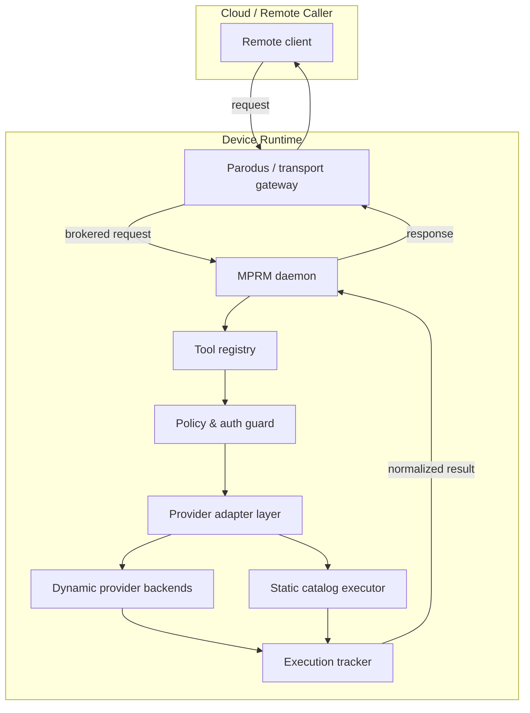
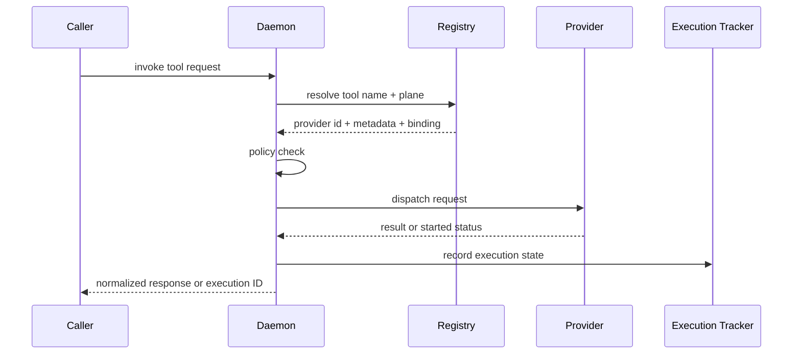
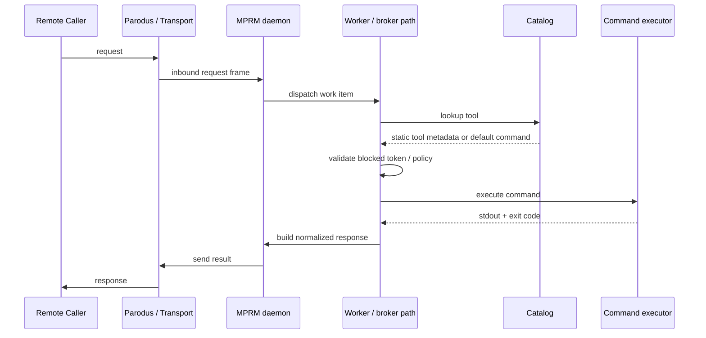
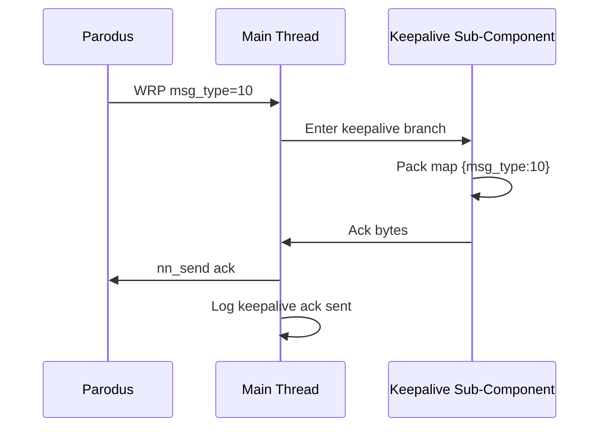
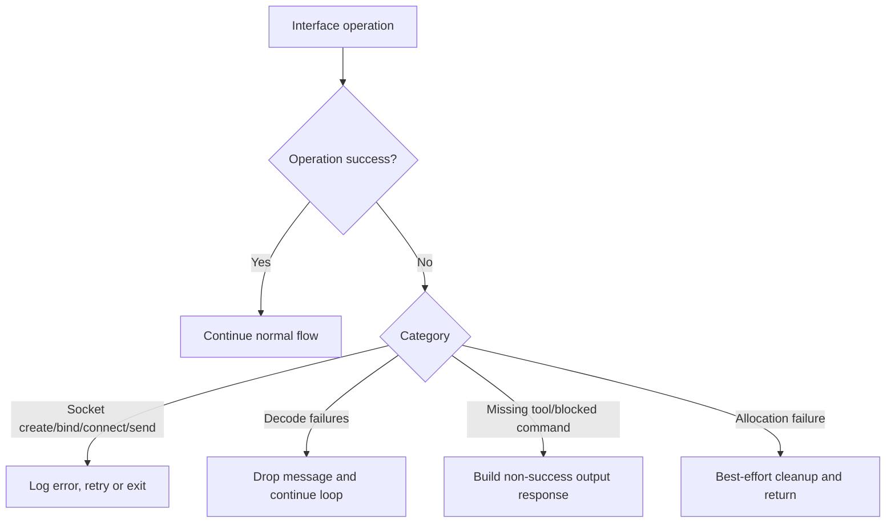
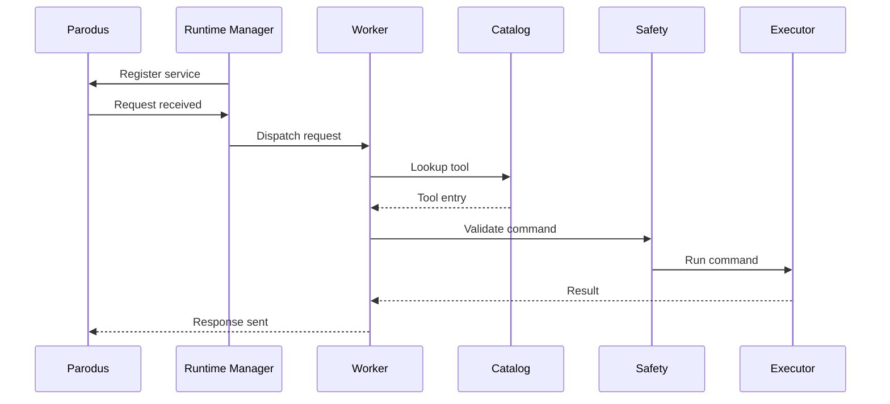

# Multi-Plane Runtime Manager Architecture

This document describes the current runtime architecture for Multi-Plane Runtime Manager (MPRM) as implemented in the service and provider layers. It reflects the current brokered execution model, multi-provider support, policy enforcement, and registry-based tool resolution, while preserving the original static catalog/command execution flow as a compatibility path.

## 0. Architectural Summary

The runtime has evolved from a simple catalog-backed executor into a brokered tool runtime that supports:

- per-plane catalog and metadata loading
- multi-backend catalog support with JSON as the default path
- registry-based tool resolution
- static tool execution and dynamic tool execution paths
- native `.so` plugins
- script-based executable providers
- external API-style providers over local IPC
- policy and ACL enforcement before invocation
- async execution tracking, polling, and cancellation
- transport-aware provider execution over Unix domain sockets or local pipe-based subprocess execution

The runtime remains the enforcement boundary. Remote callers do not invoke provider processes directly. The daemon resolves the requested tool, validates the policy context, dispatches to the appropriate provider, tracks execution state, and returns a normalized result.

## 1. System Context

At a high level, the runtime performs four major functions:

1. Accept requests from a remote or local client through the host transport layer.
2. Resolve the tool through a registry that may include static catalog entries and dynamic provider entries.
3. Enforce plane, ACL, safety, and resource policies before dispatch.
4. Execute the tool via the appropriate backend and return a normalized response.

## 2. Runtime Components

### 2.1 Request broker
The broker owns the receive loop, request validation, and response packaging. It is the single entry point for tool invocation and is responsible for:
- decoding the inbound request
- identifying tool name and target plane
- resolving provider metadata
- checking policy
- dispatching to a provider or static executor
- collecting the result and returning a normalized response

### 2.2 Tool registry
The tool registry is the source of truth for tool availability and binding. It stores:
- tool name
- plane
- provider identifier
- provider type
- metadata version
- tool schema / descriptor
- health and lifecycle state
- execution mapping for async jobs

The registry merges entries from:
- static catalog definitions
- discovered native `.so` plugins
- discovered script providers
- explicitly registered external API providers

### 2.3 Policy and auth layer
Before a tool executes, the runtime enforces:
- plane scoping
- tool conflict policy
- ACL policy
- resource policy
- metadata validation
- provider ownership / socket trust checks
- auth and registration validation for external providers

This layer is authoritative and sits between request resolution and provider dispatch.

### 2.4 Provider adapter layer
The provider adapter layer abstracts provider-specific implementation details. The runtime supports three provider families:

1. Native `.so` providers
2. Script-based providers
3. API-style external providers

Each adapter normalizes provider metadata and execution results into the runtime canonical contract.

### 2.5 Execution tracker
Execution tracking is a runtime-managed state machine for asynchronous jobs. It records:
- execution ID
- tool name
- provider ID
- plane
- status
- timestamps
- exit code
- progress
- final result payload

The tracker supports:
- start
- status fetch
- result fetch
- cancellation
- timeout handling
- stale execution cleanup

### 2.6 Static executor path
The original command-execution path still exists for tool definitions that map to static command strings or legacy catalog entries. This path remains operationally valid but is treated as one execution backend among many, not the only runtime model.

## 3. Provider Model

The runtime supports three dynamic provider styles, each with a different implementation boundary but the same broker-visible contract.

### 3.1 Native `.so` provider
A native provider implements the plugin ABI and is loaded directly by the runtime.

Required responsibilities:
- provide API version and initialization hooks
- enumerate tool descriptors
- accept canonical invoke requests
- return normalized result or deterministic runtime error
- release resources during unload or failure

This is the highest-performance provider style and is appropriate for tightly integrated native capabilities.

### 3.2 Script-based provider
A script provider is discovered as an executable or script in a trusted runtime plugin directory. It exposes metadata via `--list-tools` and executes tools via `--invoke`.

Required responsibilities:
- emit valid JSON tool metadata
- accept tool invocation through runtime-controlled process boundaries
- return structured JSON result payloads or error objects
- optionally support status and cancel for async tools

This is the lightest-weight dynamic provider model and is suitable for command wrappers and operational automation.

### 3.3 API-style external provider
An API-style external provider is a standalone process or daemon registered with the runtime. It communicates through a local IPC transport, usually:
- Unix domain socket for a persistent provider
- pipe transport for a one-shot spawn-per-request provider

Required responsibilities:
- validate provider identity and local trust boundary
- advertise tool metadata via registration or `list-tools`
- accept JSON command envelopes
- support invoke, status, cancel, and shutdown semantics
- return normalized JSON or error envelopes
- maintain execution state for async invocations

This model is the strongest option when long-lived service behavior, reconnect logic, explicit auth validation, or lifecycle management are required.

## 4. Registry and Tool Resolution

The core runtime rule is that tool resolution happens through the registry, not through direct provider access.

The registry must enforce:
- tool uniqueness within the active policy scope
- plane scoping
- duplicate resolution policy
- provider health validation
- removal or quarantine of stale providers
- tool metadata normalization before activation

Conflict policy may include:
- deny
- replace
- priority
- merge

## 5. Request Processing Flow

The request lifecycle is:

1. Client sends tool request to the daemon.
2. Daemon decodes the inbound request and transaction metadata.
3. Registry resolves tool name and provider.
4. Policy guard checks:
   - plane
   - ACL / capability
   - safety / resource limits
   - provider health / auth / socket validity
5. The request is dispatched to the selected provider or static executor.
6. The provider or executor returns a result or started state.
7. The runtime updates the execution tracker and returns a normalized result.

This is true for static commands and dynamic providers alike. The difference is only the backend used to satisfy the request.

## 6. Static Command Path (Compatibility View)

The legacy execution pipeline remains an important compatibility path:

This path still matters for legacy or static catalog-backed tool definitions. It is a specialized execution backend, not the full runtime model.

## 7. Provider Transport Model

The runtime supports a transport-neutral provider contract regardless of the physical mechanism.

### 7.1 Spawn-per-request process
Used for simple providers or wrappers:
- runtime launches process
- sends JSON request on stdin
- reads JSON response from stdout
- handles single request lifecycle
- cleans up process on completion or timeout

### 7.2 Unix domain socket provider
Used for persistent providers:
- provider listens on a trusted local socket path
- runtime connects and exchanges JSON envelopes
- session and provider liveness are tracked
- reconnect and stale-socket handling are required

### 7.3 JSON envelope contract
All provider communication uses a JSON-first envelope:

- command names such as `register`, `list-tools`, `invoke`, `status`, `cancel`
- response types such as `ack`, `result`, `error`
- request correlation using `request_id`
- execution correlation using `execution_id`
- top-level `result` and `payload` fields must remain structured JSON
- raw binary must not be used at the top level; typed `binary` payloads are accepted only when explicitly wrapped

## 8. Async Execution Lifecycle

Async execution is tracked by the runtime and is visible to callers through polling or result fetch.

Allowed states:

- `PENDING`
- `RUNNING`
- `COMPLETED`
- `FAILED`
- `CANCELED`

Transitions:

- `PENDING -> RUNNING` when invocation is accepted
- `RUNNING -> COMPLETED` when the tool finishes successfully
- `RUNNING -> FAILED` when the tool errors or the timeout expires
- `RUNNING -> CANCELED` when cancellation is requested
- `PENDING -> CANCELED` if cancellation happens before execution starts

The runtime must:
- maintain stable execution records
- prevent stale result overwrites
- track provider and execution IDs separately
- support status polling and final result retrieval

## 9. Provider Lifecycle

Providers themselves are also stateful.

Provider states:

- `REGISTERING`
- `ACTIVE`
- `DRAINING`
- `DEGRADED`
- `FAILED`
- `UNLOADED`

Transitions:
- `REGISTERING -> ACTIVE` on successful validation and activation
- `ACTIVE -> DRAINING` on shutdown or reload
- `DRAINING -> UNLOADED` when work drains or timeout occurs
- `ACTIVE -> DEGRADED` on soft failures
- `DEGRADED -> FAILED` on repeated transport or validation problems
- `ACTIVE -> FAILED` if the provider exits unexpectedly or the socket disappears

This state machine is required regardless of provider type.

## 10. Policy and Security Boundaries

The runtime enforces policy at multiple points:

- transport validation
- provider registration validation
- socket ownership and permission checks
- plane restrictions
- tool conflict resolution
- command safety and ACL checks
- resource constraints
- timeout and cancellation enforcement

The daemon is the security boundary. The provider may be a local child process or a daemon, but it is never allowed to bypass the broker’s validation and registry logic.

## 11. Interface Model

### 11.1 Local transport
The runtime interacts with:
- Parodus / gateway transport for request ingress and response egress
- local Unix sockets for provider registration and execution
- local process pipes for script and spawn-per-request execution

### 11.2 External API interfaces
The runtime exposes:
- registration interfaces
- lookup and list interfaces
- invoke interfaces
- status and cancel interfaces
- result fetch interfaces

These interfaces are intentionally brokered and normalized so callers do not need to know the underlying provider implementation.

## 12. Operational Behavior

The runtime is expected to:
- accept both static and dynamic tools
- resolve tools through a common registry
- reject conflicting or untrusted registrations
- isolate provider failures
- detect stale providers and stale execution records
- support graceful reload and clean shutdown
- preserve observability through execution logs, states, and normalized error codes

## 13. Notes on Current Implementation

The current service implementation already contains:
- per-plane catalog loading
- dynamic plugin discovery and validation
- runtime normalization and guard checks
- policy gating before execution
- dynamic provider support via a plugin manager and registry abstractions
- brokered execution semantics for tool activation

This architecture document reflects the current direction of the codebase: the runtime is no longer only a direct command executor; it is a brokered tool runtime with a registry, provider adapters, lifecycle tracking, and policy enforcement.

## 14. Conclusion

The runtime’s design is now best understood as a layered broker architecture:

- transport layer
- request broker
- registry and conflict resolver
- policy and auth guard
- provider adapter layer
- execution tracker
- static compatibility executor

This makes the runtime extensible across native plugins, script providers, and external API-style providers while preserving a single enforcement point for security, policy, and execution semantics.

### 6.6 Keepalive Interface Workflow (WRP Type 10)

Primary code path mapping:
- main loop branch for WRP_MSG_TYPE_ALIVE.

### 6.7 Error Handling Sub-Workflow

Primary code path mapping:
- main: retries connection and logs I/O errors.
- handle_request: emits controlled outputs for missing/blocked command conditions.
- decode helpers: tolerate malformed maps by not progressing to execution.

## 7. Device-Side Communication Workflow (Presentation View)

Key messaging paths on the device:
- Inbound request path: Parodus -> Multi-Plane Runtime Manager PULL (127.0.0.1:6669).
- Outbound response path: Multi-Plane Runtime Manager PUSH -> Parodus (127.0.0.1:6666).
- Control path: keepalive ping/ack (WRP type 10) handled inline by main thread.
