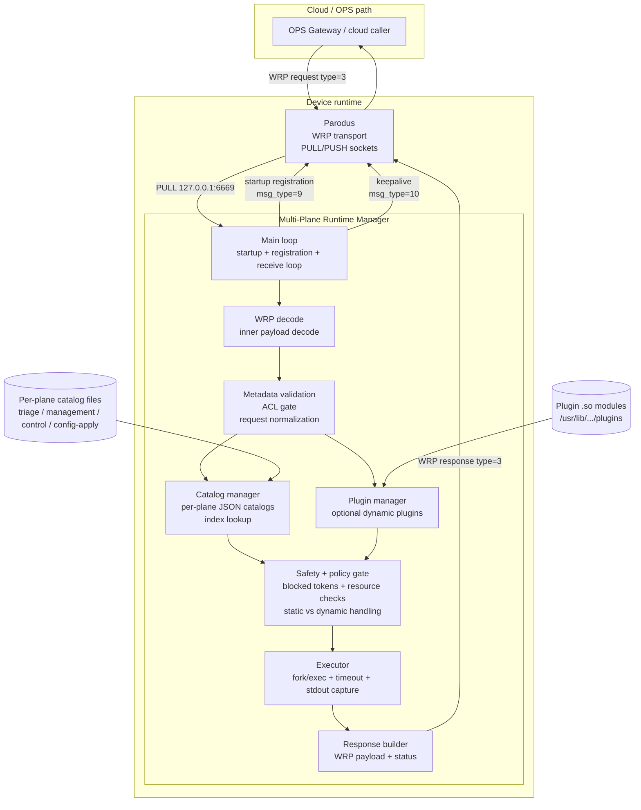
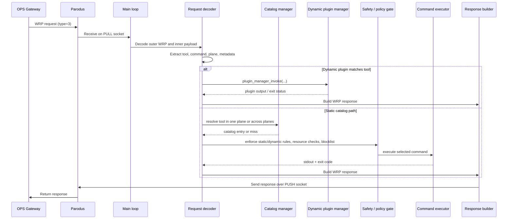
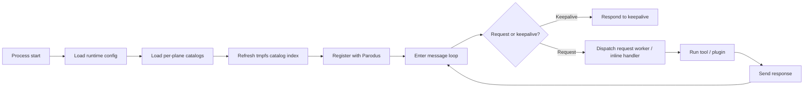

# Multi-Plane Runtime Manager Components and Workflow

This diagram is derived from the implementation in [src/rdk-service-hub.c](../src/rdk-service-hub.c), the optional plugin runtime in [src/plugin_manager.c](../src/plugin_manager.c), and the design references in [docs/ARCHITECTURE.md](ARCHITECTURE.md), [README.md](../README.md), and [docs/guides/API_WORKFLOW_FUNCTIONALITY_GUIDE.md](guides/API_WORKFLOW_FUNCTIONALITY_GUIDE.md).

## 1. Component architecture

### Responsibilities

- Main loop: startup, registration, socket lifecycle, receive loop, and keepalives.
- Catalog manager: loads plane-specific catalog JSON files and resolves tool names by plane.
- Metadata / ACL gate: validates request metadata and denies unauthorized execution before catalog/path execution.
- Plugin manager: loads dynamic plugins and intercepts tool requests before the static catalog path.
- Safety gate: enforces static vs dynamic semantics, blocklisted program tokens, resource policy, and catalog validation state.
- Executor: runs the final command, applies timeout and output limits, and returns exit/status information.
- Response builder: wraps execution output in a WRP response and sends it back to Parodus.

---

## 2. Request processing workflow

### Execution path from source

1. The service receives a WRP request in the receive loop and decodes the payload in [src/rdk-service-hub.c](../src/rdk-service-hub.c#L3453-L3995).
2. The request is checked for metadata and ACL constraints before catalog execution in [src/rdk-service-hub.c](../src/rdk-service-hub.c#L3525-L3595).
3. A plugin invocation path runs before the static catalog path when plugins are enabled, as shown in [src/rdk-service-hub.c](../src/rdk-service-hub.c#L3595-L3685).
4. For static tools, the catalog is looked up by tool and optional plane in [src/rdk-service-hub.c](../src/rdk-service-hub.c#L979-L1165).
5. The final command is run with timeout and output capture in [src/rdk-service-hub.c](../src/rdk-service-hub.c#L2874-L3230).
6. The response is wrapped back into WRP and sent to Parodus in the same handle flow in [src/rdk-service-hub.c](../src/rdk-service-hub.c#L3995-L4065).

---

## 3. Startup and lifecycle view

### Startup model

- The runtime can load multiple catalog files from a directory, not just a single file; this is documented in [src/rdk-service-hub.c](../src/rdk-service-hub.c#L237-L243) and implemented in [src/rdk-service-hub.c](../src/rdk-service-hub.c#L979-L1047).
- A tmpfs-backed catalog index is refreshed during startup, as seen in [src/rdk-service-hub.c](../src/rdk-service-hub.c#L943-L978).
- Dynamic plugins are optional and discovered from configured plugin directories, as implemented in [src/plugin_manager.c](../src/plugin_manager.c#L103-L220).

---

## 4. Design mapping to the docs

| Source area | Design meaning |
| --- | --- |
| [src/rdk-service-hub.c](../src/rdk-service-hub.c) | Runtime service implementation and full control flow |
| [src/plugin_manager.c](../src/plugin_manager.c) | Optional dynamic plugin loading and dispatch |
| [docs/ARCHITECTURE.md](ARCHITECTURE.md) | High-level architecture diagram and text |
| [README.md](../README.md) | Current runtime model and operational defaults |
| [docs/guides/PLANES_AND_USE_CASES.md](guides/PLANES_AND_USE_CASES.md) | Conceptual plane routing and use cases |
| [docs/guides/API_WORKFLOW_FUNCTIONALITY_GUIDE.md](guides/API_WORKFLOW_FUNCTIONALITY_GUIDE.md) | Detailed request handling guidance |

This document intentionally tracks the source-of-truth behavior in code and cross-references the project documentation rather than showing a stale or simplified legacy design.
