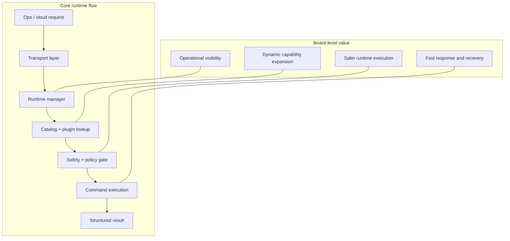
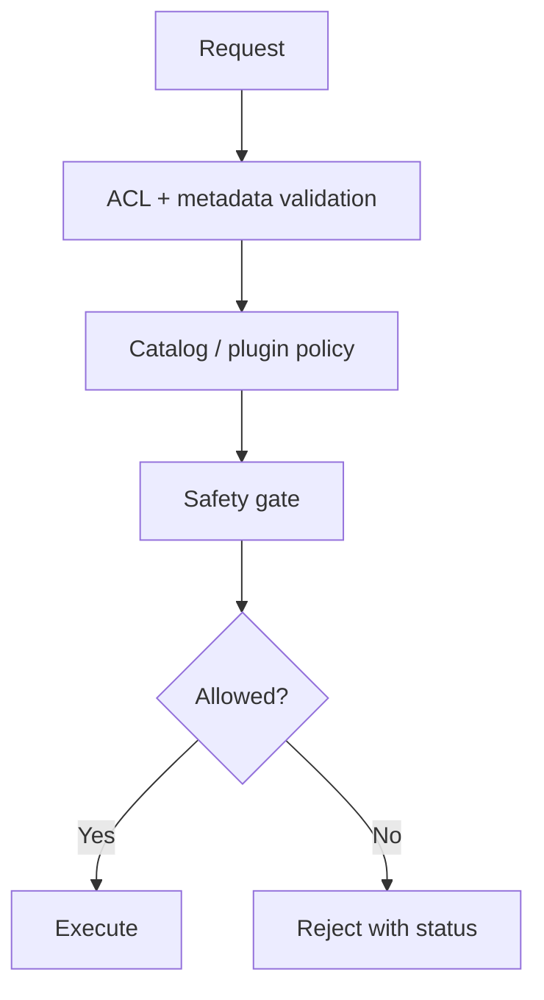
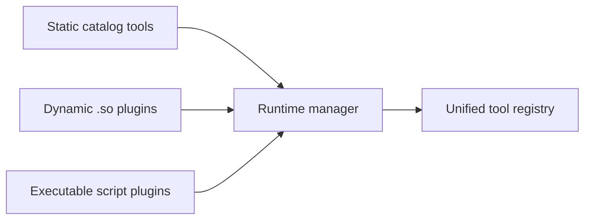

# Multi-Plane Runtime Manager Executive Board View

## Executive summary

The Multi-Plane Runtime Manager is a secure, runtime-owned control layer that exposes operational tools through a catalog and dynamic plugin model. It accepts requests from the cloud/ops path, resolves the correct tool or plugin, enforces policy and safety checks, executes the command, and returns a structured response.

---

## Executive board diagram

---

## Board view by capability

### 1. What the runtime does

- Receives requests from connected operational systems
- Resolves tools by catalog or runtime plugin
- Chooses the correct command path for each request
- Returns the execution result in a normalized response payload

### 2. How the runtime stays safe

- Validates input metadata
- Enforces ACL and catalog policy checks
- Restricts plugin loading to trusted directories
- Blocks unsafe command patterns and invalid dynamic paths
- Tracks invocation failures and runtime metrics

### 3. Why it is flexible

- Supports static catalog-based tools
- Supports optional dynamic .so plugin loading
- Supports executable script plugins
- Re-scans the plugin directory as the environment changes
- Logs startup and dynamic tool visibility for operators

### 4. Operational outcomes

- Better tool discoverability
- Lower operational risk
- Faster rollout of new diagnostics
- Clear startup and runtime inventory for troubleshooting
- Better lifecycle control for plugin health and change management

---

## Executive takeaway

This runtime is designed as a secure operational platform: it turns a set of capabilities into a managed runtime inventory, enforces safety before execution, and supports both fixed catalog tools and runtime-loaded extensions without forcing a process restart.
