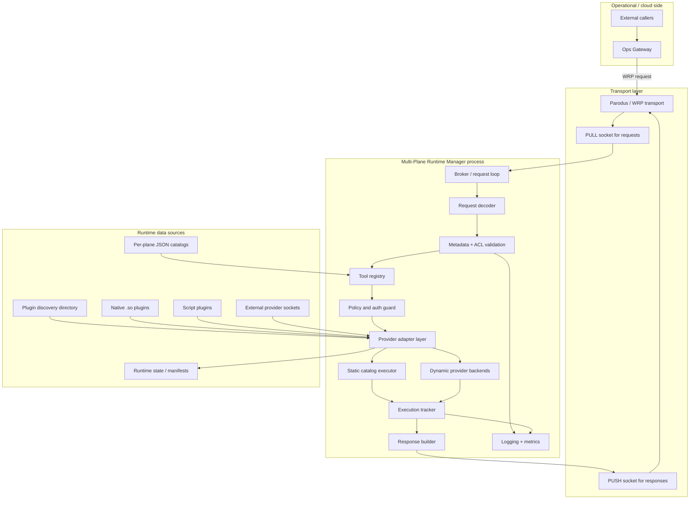
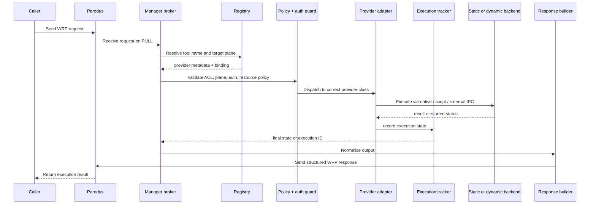

# Multi-Plane Runtime Manager Single-Page Architecture

## Runtime architecture overview

---

## Runtime flow in one pass

---

## Component responsibilities

### 1. Transport and entry
- Receives requests from the external operations path
- Dispatches responses back to the connected caller
- Maintains the runtime socket lifecycle and registration flow

### 2. Request validation
- Decodes and normalizes the incoming request
- Applies ACL and metadata rules
- Rejects invalid or unauthorized execution attempts before runtime work begins

### 3. Registry and provider resolution
- Resolves a tool against the current catalog set and active dynamic provider set
- Uses a unified registry to bind tool names to provider metadata
- Maintains provider state and handles conflict policy across provider classes

### 4. Safety and policy enforcement
- Confirms commands are allowed
- Validates provider trust, ownership, and socket/auth policy
- Applies blocklists, resource rules, and plane-scoping checks
- Ensures only valid and trusted providers are activated

### 5. Execution and output
- Executes approved commands or invokes provider handlers through the adapter layer
- Tracks async execution state, status, and cancellation
- Returns a consistent response payload for the caller

### 6. Observability and health
- Emits startup and dynamic tool inventory logs
- Records invocation, policy, and error metrics
- Generates a manifest of active provider state and tool coverage

---

## Architectural summary

The runtime is organized as a layered brokered control path:

1. External caller enters through Parodus / WRP transport.
2. The broker validates the request and resolves the correct provider path through the registry.
3. Catalogs and dynamic providers contribute to the runtime capability set.
4. Safety and policy checks gate execution.
5. The selected provider adapter executes the command or provider call.
6. Async state and final execution result are tracked and returned via a normalized runtime response.

This gives the system a clean separation across transport, validation, registry, provider dispatch, execution, and observability while keeping the runtime itself extensible across native, script, and external API-style provider models.
