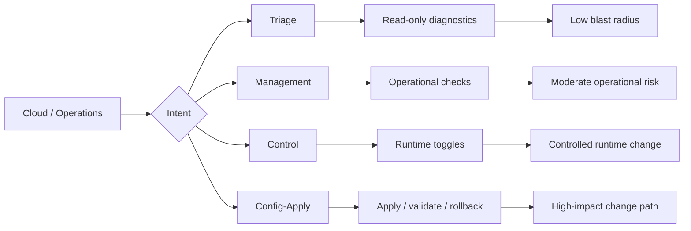
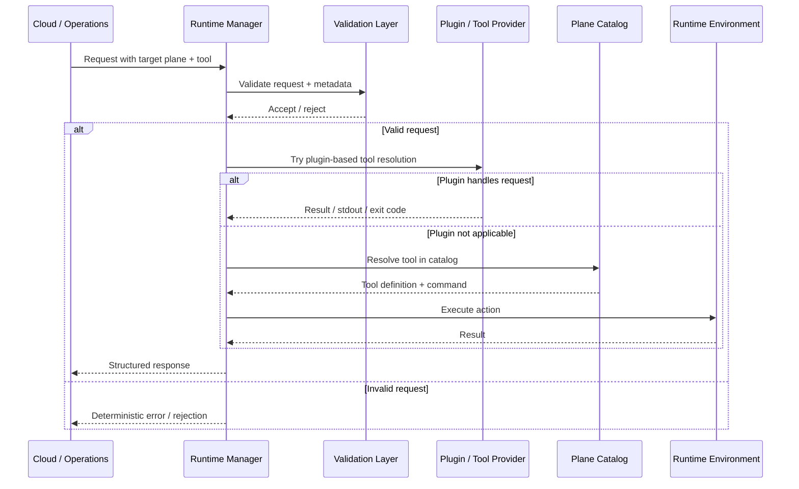
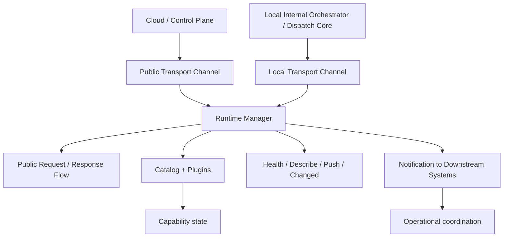

# 03 — Fuller Executive Narrative with Diagrams

## Chat

"a fuller executive-friendly narrative for a presentation with few diagrams showing the capabilities and transport and communication methods"

## Response

### Opening message

This module is the operational control layer for a multi-plane runtime environment. Its purpose is to make device capabilities discoverable, governable, and upgradeable across different operational contexts without forcing every action through the same risk profile. In practical terms, it gives the organization a disciplined way to diagnose, manage, control, and update distributed device capabilities while preserving safety, scalability, and deployment agility.

At a business level, the module addresses a common but costly problem: as device ecosystems become more distributed and more complex, teams end up with fragmented visibility, inconsistent update paths, and slower incident response. The result is operational drag, higher support cost, and delayed product velocity. This module reduces that complexity by creating a single, policy-aware control model for how capabilities are exposed and changed.

---

### The business context

Modern product environments do not behave like a single system. They are composed of multiple planes of activity with different intent and different risk:

- Triage: read-only visibility and diagnostics
- Management: operational action and service oversight
- Control: runtime behaviors and policy changes
- Config-apply: high-impact configuration adoption and rollback

Without a controlled model, the same system can be used for diagnostic reads, operational actions, and major configuration changes in ways that blur responsibility and increase operational risk. This module creates structure around that complexity.

---

### What the system does

The system acts as a coordinated runtime catalog and execution layer. It receives requests, identifies the right operational plane, validates the request, resolves the correct capability, and executes it using either a catalog route or a plugin-based route.

The key value is not simply “command execution.” It is disciplined orchestration:
- ensure the caller is asking for the right capability
- ensure the request is valid for the right plane
- execute under the correct governance
- return structured responses and status
- emit change notifications when capability state changes

This is how it turns a fragmented set of runtime actions into an operational platform.

---

## Diagram 1 — Capability model by use case

This diagram shows the operating model behind the product. The system recognizes that not all requests are equal. Some actions are meant only for observation, while others are intended to modify runtime behavior or change configuration. By separating those functions by plane, the organization reduces accidental change, supports better governance, and can assign the right level of operational ownership to each category.

---

## Diagram 2 — Request flow and execution pattern

This is the core operating workflow. Requests come in through a consistent channel, are validated before execution, and are resolved through either a plugin or a catalog-defined path. The business benefit is clear: the system does not improvise. It gives the organization a standard execution model with guardrails, error handling, and service accountability.

This is also where the rpcd-style architecture becomes important. The host process behaves like a daemon service endpoint, while plugins behave like callable service modules. That design supports extensibility without creating unpredictable custom integrations.

---

## Diagram 3 — Communication and transport model

This diagram shows the communication model used by the system. There are two important transport paths:

- A public path for cloud-facing requests and responses
- A local path for internal coordination and nearby system communication

The implementation is designed so the public path remains operational while a local path can be enabled additively for local steering, notifications, and control-plane coordination. That is strategically important because it supports gradual adoption. The system can expand capability without forcing a disruptive migration or replacing the existing public ecosystem.

The module also supports messages for:
- Describe: capability discovery
- Health: liveness and service readiness
- Push: controlled change propagation
- Changed: event notification after successful promote

These are not just technical artifacts—they represent a governance model for operational change.

---

### Why the rpcd-style model matters to leadership

The rpcd-style plugin model gives the platform a practical balance between flexibility and control:

- New tool capabilities can be added without rewriting core system logic
- The system can expand its capabilities as product requirements evolve
- Tool execution remains under a fixed contract and standard behavior
- Governance can be applied consistently across all plugin-backed actions
- Deployment teams can use safer, modular extension rather than fragile custom integration

This is the strategic advantage: extensibility without uncontrolled drift.

---

### Executive takeaway

This module is not simply a runtime feature; it is a control and governance layer for distributed capabilities. It creates a safer, smarter, and more scalable way to handle diagnostics, operations, runtime control, and configuration updates across multiple planes. By combining a structured use-case model with a stable rpcd-style execution pattern and a layered communication architecture, the organization gains:

- safer operations
- faster response to incidents
- controlled rollout of capabilities
- reduced operational complexity
- better scalability without increasing manual burden

In one sentence: it turns fragmented runtime operations into a governable platform capability.
