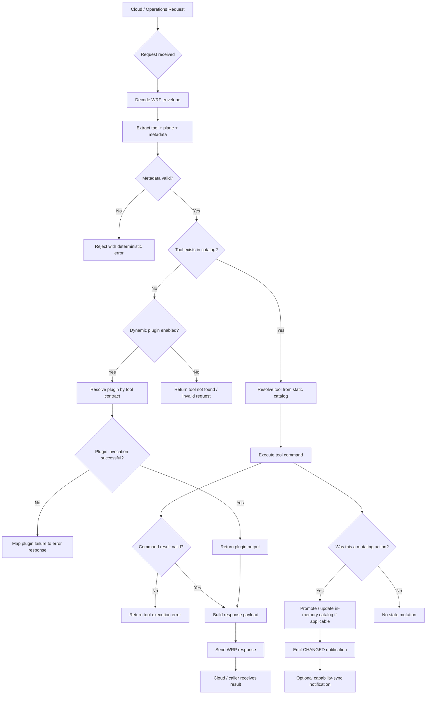
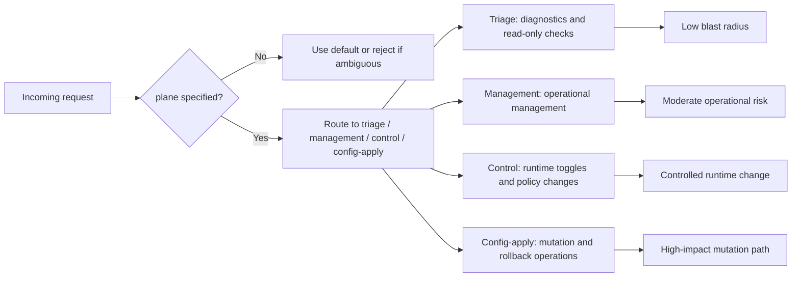
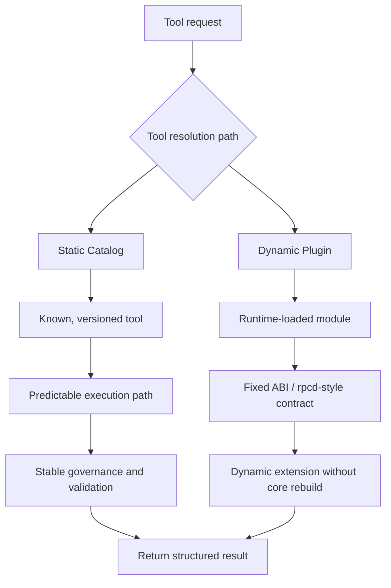
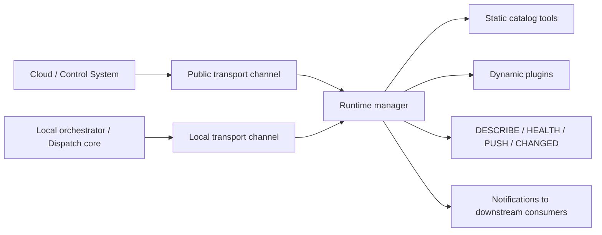

# 06 — Code Workflow Diagram (Textual / Mermaid)

## Runtime request workflow

## Plane-aware capability routing

## Static vs dynamic tool handling

## Communication and transport model

## Summary in plain language

The workflow is:
1. Receive the request.
2. Decode and validate request metadata.
3. Resolve the right tool by plane.
4. Prefer a static catalog path when applicable; otherwise use the dynamic plugin path.
5. Execute the action under governance controls.
6. Return a structured response.
7. If the action mutates runtime state, emit the relevant change notification.

This gives the system a disciplined runtime lifecycle: request validation, safe execution, controlled delivery, and operational visibility.
