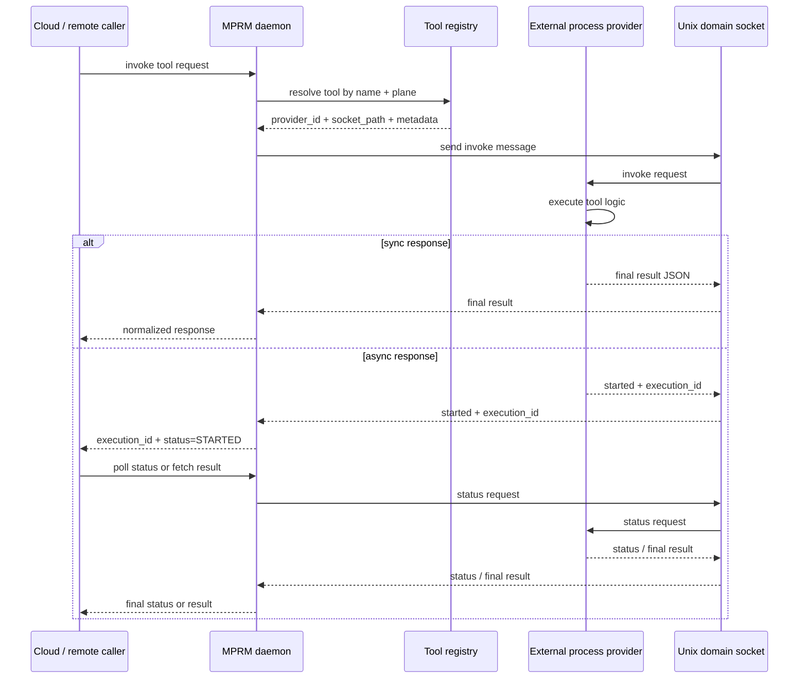

# Dynamic Tool Registration and Remote Execution Spec

## 1. Purpose

This specification defines how Multi-Plane Runtime Manager (MPRM) discovers, registers, invokes, and manages tool providers from three sources:

- native shared libraries (`.so` plugins)
- script or executable plugins
- external processes that dynamically register one or more tools at runtime

The runtime must provide a single registry and invocation contract regardless of provider type, while allowing remote callers to trigger both synchronous request/response tools and asynchronous long-running process tools.

The daemon is the broker for all tool execution: remote callers never talk directly to the external provider process. Instead, the daemon resolves the tool in the registry, validates plane and policy, forwards the request over the provider transport, tracks execution state, and normalizes the provider response before returning it to the caller.

The spec intentionally supports both tool registration by file discovery and registration by explicit API call from another process or service.

## 2. Goals

- unify discovery and registration across `.so`, script, and external-process tool providers
- support conflict detection and policy enforcement for duplicate tool names
- allow explicit registration from other trusted processes
- allow remote request dispatch to a tool without requiring the caller to know the provider implementation
- support both immediate results and asynchronous execution with status tracking
- maintain the same security, ownership, and policy boundaries for all providers

## 3. Non-goals

- arbitrary remote code execution from untrusted sources
- accepting registration from non-authenticated or untrusted processes
- exposing raw process execution primitives without policy checks
- bypassing the runtime registry and direct tool dispatch

## 4. Terminology

- Tool: a named capability exposed by a provider and addressed by name.
- Provider: a `.so` plugin, script plugin, or external process that offers tools.
- Provider type: one of `native`, `script`, or `external-process`.
- Toolset: the set of tools exposed by a provider instance.
- Registration: the act of binding a provider and its tool names to the runtime registry.
- Invocation: the host-initiated call into a provider for synchronous or asynchronous execution.
- Execution handle: a token returned for long-running work that can be polled for status.

## 5. Core Principles

### 5.1 Shared registry contract

All providers must satisfy the same registry contract:

- a provider exposes one or more tool names
- each tool has a stable name, description, plane, provider, and capability flags
- the host resolves a tool by name through a single registry
- the runtime enforces conflict policy before accepting a tool

### 5.2 Provider neutrality

The runtime must treat provider implementations uniformly:

- `.so` plugin tools are loaded with `dlopen()` and exported functions
- script tools are discovered by `--list-tools` and invoked via `--invoke`
- external-process tools are registered by API or socket and invoked over a process protocol

### 5.3 Security baseline

All providers must satisfy these security requirements:

- provider path must be confined to an approved runtime-owned or configured directory
- ownership checks must be enforced when filesystem-backed providers are used
- external-process registration must require authentication, trust, or local socket ownership
- tool names must be unique within the active conflict policy scope
- tool invocation must be traced with source, plane, and transaction UUID metadata

## 6. Provider Registration Model

### 6.1 Registration sources

A provider may be registered from one of these sources:

1. discovery at startup or reload from a configured dynamic plugin directory
2. explicit registration via a local runtime API
3. explicit registration via a local IPC endpoint or UNIX socket
4. explicit registration via a trusted broker process

### 6.2 Registration lifecycle

A provider moves through the following states:

- `REGISTERING`
- `ACTIVE`
- `DRAINING`
- `UNLOADED`
- `FAILED`
- `DEGRADED`

State transitions:

- `REGISTERING -> ACTIVE` when all tools are validated and bound
- `ACTIVE -> DRAINING` when a reload, replacement, or shutdown begins
- `DRAINING -> UNLOADED` after in-flight operations complete or timeout
- `ACTIVE -> FAILED` when validation or invocation cannot be established

## 7. Common Tool Definition

Every provider must expose a tool descriptor with at least these fields:

```json
{
  "name": "packet_capture",
  "description": "Starts a packet capture on the selected interface",
  "plane": "triage",
  "provider_type": "native",
  "invoke_mode": "sync",
  "schema": {
    "input": "object",
    "output": "object"
  },
  "capabilities": ["start", "query", "cancel"],
  "timeout_ms": 30000,
  "supports_async": false
}
```

Field definitions:

- `name`: unique tool name across the selected scope
- `description`: user-visible description
- `plane`: runtime plane used for routing and policy checks
- `provider_type`: `native`, `script`, or `external-process`
- `invoke_mode`: `sync` or `async`
- `schema`: optional JSON schema for input/output validation
- `capabilities`: optional verbs supported by the tool
- `timeout_ms`: maximum expected execution duration for sync tools
- `supports_async`: true for long-running jobs that return a handle

## 8. Native `.so` Plugin Contract

A native provider must implement the following ABI symbols:

```c
int diag_plugin_get_api_version(void);
int diag_plugin_init(const diag_host_api_t *host, diag_plugin_ctx_t **ctx);
size_t diag_plugin_get_tool_count(diag_plugin_ctx_t *ctx);
int diag_plugin_get_tool(diag_plugin_ctx_t *ctx, size_t index, diag_tool_def_t *out);
int diag_plugin_invoke(diag_plugin_ctx_t *ctx, const diag_invoke_req_t *req, diag_invoke_resp_t *resp);
void diag_plugin_deinit(diag_plugin_ctx_t *ctx);
```

Required semantics:

- `diag_plugin_get_api_version()` must return `DIAG_PLUGIN_API_VERSION`
- `diag_plugin_init()` must allocate and initialize provider context
- `diag_plugin_get_tool_count()` must return the number of exported tools
- `diag_plugin_get_tool()` must fill tool metadata for the requested index
- `diag_plugin_invoke()` must honor `req->tool` and return a structured response
- `diag_plugin_deinit()` must release any provider resources

## 9. Script Plugin Contract

A script or executable provider must behave as follows:

- the runtime executes the script with `--list-tools` and expects a JSON list of tool descriptors
- the runtime executes the script with `--invoke <tool_name> <payload-json>` and expects a JSON result object
- the script must return machine-readable JSON for both metadata and execution
- the runtime must normalize both outputs into the canonical `diag_invoke_resp_t` contract

Example tool list JSON:

```json
{
  "tools": [
    {
      "name": "system_cpu_usage",
      "description": "Returns current CPU usage snapshot",
      "plane": "management",
      "provider_type": "script",
      "invoke_mode": "sync",
      "supports_async": false
    }
  ]
}
```

Example invocation response JSON:

```json
{
  "status": "ok",
  "exit_code": 0,
  "stdout": "{\"cpu_percent\": 23.8}",
  "stderr": "",
  "tool": "system_cpu_usage",
  "execution_id": ""
}
```

If the provider supports asynchronous execution, it may return a non-empty `execution_id` and set `status` to `started`.

## 10. External Process Tool Registration Contract

This registration model allows another process to expose tools to MPRM without shipping a shared library. The default runtime model is a spawn-per-request process: the runtime starts a provider process for a specific tool execution, validates the result, then exits without keeping a long-lived dedicated provider daemon alive unless a deployment explicitly opts into a persistent provider model. The registry is in-memory only and exists for the process lifetime; no persisted registry recovery across daemon restart is required in the baseline implementation. The baseline socket namespace is a fixed runtime-owned path under `/var/run/mprm/`, with one socket per provider or per tool as needed by the deployment.

### 10.1 Registration API

The runtime exposes the following registration interface to trusted local callers:

```c
int tool_registry_register_external(
    const tool_register_req_t *req,
    tool_register_resp_t *resp);

int tool_registry_unregister_external(
    const char *provider_id,
    const char *tool_name,
    tool_register_resp_t *resp);

int tool_registry_list_external(
    tool_descriptor_t **tools,
    size_t *count);
```

### 10.2 Registration request object

```c
typedef struct {
    char provider_id[128];
    char provider_name[128];
    char plane[32];
    char process_path[512];
    char socket_path[512];
    char auth_token[256];
    uint32_t flags;
    uint32_t request_timeout_ms;
    int supports_async;
    tool_descriptor_t tools[64];
    size_t tool_count;
} tool_register_req_t;
```

### 10.3 Registration response

```c
typedef struct {
    int status;
    char provider_id[128];
    char error[256];
    int registered_tools;
} tool_register_resp_t;
```

### 10.4 External process transport and provider-side protocol

The runtime must prefer the following external-provider transport ordering:

1. stdin/stdout RPC over a child process pipe for spawn-per-request execution (default for simple tools)
2. Unix domain socket for explicitly persistent providers that need to stay alive across multiple requests

The daemon is always the broker and always the client side of the connection. A provider process does not accept direct remote calls from cloud callers. Instead, the provider process receives JSON requests from the daemon over the selected transport and must return a JSON response framed in the same envelope schema.

The provider-side protocol is intentionally transport-neutral:

- a simple tool can be executed by forking a provider process, passing a JSON request on stdin, and reading the JSON response on stdout
- a long-lived provider can accept a connection on a Unix domain socket and exchange the same JSON envelopes over a persistent stream
- the broker uses the same command set and response contract in both cases

The runtime must reject or quarantine any provider whose socket is not owned by a trusted user or whose path and permissions violate the runtime’s local trust policy. The default auth model is socket ownership and permission validation only; a shared token or signed registration payload may be added later as a stronger deployment-specific option, but it is not required for the baseline local daemon model.

Design decision: a spawn-per-request process is the default model for the first implementation because it keeps the runtime simple, isolated, and easy to validate. A Unix domain socket is still the preferred transport for persistent providers that need long-lived registration or async state, but it is not required for simple one-shot external tools.

Provider-side commands are not shell commands; they are JSON envelope `type` values:

- `register` for initial provider registration and tool metadata advertisement
- `list-tools` for enumerating tools exposed by the provider
- `invoke` for synchronous or asynchronous tool execution
- `status` for polling an execution status record
- `cancel` for canceling a running execution

The provider must always answer with a JSON envelope whose `type` is one of `ack`, `result`, or `error`. A successful `invoke` may return `status` as `ok`, `started`, or `completed`, while failure results must use `type` = `error` with deterministic runtime error codes.

### 10.5 Reference implementation outline

The runtime should implement the following minimal reference flow for external providers. Each function below has a single responsibility and should be kept independent from the transport implementation.

- `tool_registry_register_external()`
  - validates provider identity, socket ownership, auth token, and plane scope
  - allocates a provider record and inserts it into the provider registry
  - rejects duplicate provider IDs or conflicting tool names under the active policy

- `tool_registry_unregister_external()`
  - marks the provider `DRAINING` and waits for in-flight requests to finish or timeout
  - removes registry entries only after state transition is complete

- `tool_registry_list_external()`
  - returns only active and valid provider tools for the requesting scope, without exposing stale records

- `tool_provider_validate_socket()`
  - verifies that a Unix socket path exists, is a socket, and is owned by a trusted local user or group

- `tool_provider_validate_metadata()`
  - checks tool names, plane names, capabilities, and response schema before activation

- `tool_dispatch_invoke()`
  - resolves a tool name to a provider, applies plane policy, serializes the request, and dispatches it over the selected transport

- `tool_dispatch_status()`
  - looks up an execution record by `execution_id` and returns a normalized status payload

- `tool_dispatch_cancel()`
  - marks an in-flight execution as `CANCELED` and initiates provider-side cancellation when supported

- `tool_execution_record_create()`
  - creates a stable execution record keyed by `execution_id` with timestamps, tool, provider, and transaction metadata

- `tool_execution_record_update()`
  - updates lifecycle state, progress, exit code, and final payload without mutating the history record

This outline keeps the runtime broker logic isolated from the specific provider transport while preserving a single registry and status contract.

### 10.6 Provider-side reference implementation contract by style

The runtime must accept three provider implementation styles and each style must satisfy the same broker-visible contract even though the provider-specific ABI or transport differs. The contract is defined at the provider boundary: registration, capability discovery, execution, status, cancellation, and shutdown.

#### 10.6.1 Native `.so` provider contract

A native provider is a shared library loaded by the runtime and must implement the provider lifecycle and tool invocation ABI.

Required ABI functions:

```c
int diag_plugin_get_api_version(void);
int diag_plugin_init(const diag_host_api_t *host, diag_plugin_ctx_t **ctx);
size_t diag_plugin_get_tool_count(diag_plugin_ctx_t *ctx);
int diag_plugin_get_tool(diag_plugin_ctx_t *ctx, size_t index, diag_tool_def_t *out);
int diag_plugin_invoke(diag_plugin_ctx_t *ctx, const diag_invoke_req_t *req, diag_invoke_resp_t *resp);
void diag_plugin_deinit(diag_plugin_ctx_t *ctx);
```

Required semantics:

- `diag_plugin_get_api_version()` must return the supported plugin API version and reject unknown versions
- `diag_plugin_init()` must allocate provider context and validate its dependency surface
- `diag_plugin_get_tool_count()` must return the number of exported tools
- `diag_plugin_get_tool()` must fill a tool descriptor with a stable name, plane, description, and `supports_async` value
- `diag_plugin_invoke()` must honor the requested tool name and return a deterministic result or error envelope
- `diag_plugin_deinit()` must gracefully release all resources and leave no stale execution handles behind

Required runtime-visible behavior:

- no direct use of raw process memory or host internals outside the allowed API surface
- result payloads must be normalized to the canonical broker contract before leaving the plugin
- provider failures must map to deterministic runtime error codes such as `ERR_PROVIDER_UNAVAILABLE` or `ERR_REMOTE_DISPATCH_FAILED`

#### 10.6.2 Script provider contract

A script provider is a standalone executable or script that implements a JSON contract for tool discovery and invocation. It must be executed by the runtime through a controlled process boundary.

Required CLI contract:

- `--list-tools` returns a JSON object with a `tools` array
- `--invoke <tool_name> <payload-json>` returns a JSON result object or error object
- optional `--status <execution_id>` and `--cancel <execution_id>` commands are required when async execution is supported

Required result semantics:

- output must be valid UTF-8 JSON only
- top-level result fields must be structured objects or arrays
- execution result must include `status`, `tool`, and `execution_id` when async is used
- provider returns non-zero exit status only for transport or runtime-level failure; tool-level failures remain in the JSON error field

Minimal JSON response contract:

```json
{
  "status": "ok",
  "tool": "system_cpu_usage",
  "execution_id": "",
  "result": {"cpu_percent": 23.8}
}
```

For async execution:

```json
{
  "status": "started",
  "tool": "long_running_capture",
  "execution_id": "d63f5e5d-9a4b-4c3d-bc87-e4f2d516acaa",
  "result": null
}
```

#### 10.6.3 External process provider contract

An external provider is a process that registers with the runtime and then participates in a brokered local IPC contract. It must support the same provider lifecycle semantics even though the actual transport may be a pipe or a Unix domain socket.

Required commands:

- `register`
- `list-tools`
- `invoke`
- `status`
- `cancel`
- `shutdown` or equivalent termination flow

Required response envelope:

```json
{
  "version": 1,
  "type": "ack",
  "request_id": "a1b2c3",
  "timestamp_ms": 1728319200000,
  "status": "started",
  "execution_id": "d63f5e5d-9a4b-4c3d-bc87-e4f2d516acaa",
  "result": null
}
```

Required semantics:

- the provider must not accept direct remote calls from cloud callers
- all commands must be JSON-only at the envelope boundary
- the provider must echo `request_id` in every response
- `invoke` may return `status` = `started` for async work and later `completed` or `failed`
- `cancel` must either stop the running work or return a deterministic `ERR_EXECUTION_CANCELED` status
- a stale provider must be detected through heartbeat, socket liveness, or heartbeat timeout and moved to `FAILED` or `DRAINING`

#### 10.6.4 Shared provider lifecycle contract

All provider implementations must satisfy the following lifecycle model:

1. registration or startup
2. capability discovery and validation
3. runtime activation
4. tool invocation
5. status and result tracking
6. cancellation when requested
7. graceful shutdown or failure quarantine

Provider states:

- `REGISTERING`
- `ACTIVE`
- `DRAINING`
- `DEGRADED`
- `FAILED`
- `UNLOADED`

The runtime must treat provider failures consistently regardless of provider type. A provider that fails repeated validation, disappears unexpectedly, or no longer answers status checks must be placed into a failed or draining state instead of remaining active in the registry.

#### 10.6.5 Reference contract summary

The provider contract across all styles is:

- validate identity and trust boundary before activation
- advertise stable tool descriptors with plane and metadata
- accept requests through the daemon broker only
- return structured JSON responses and deterministic error codes
- support async status and cancellation when the tool is long running
- keep lifecycle and liveness state visible to the runtime

This contract defines the minimum behavior expected from any dynamic provider implementation, regardless of whether the provider is a native plugin, script, or external process.

## 11. Runtime API for Remote Execution

The runtime must expose a single host-level contract for both internal and external providers.

### 11.1 Invoke request

```c
typedef struct {
    char transaction_uuid[64];
    char source[64];
    char plane[32];
    char tool[128];
    char provider_id[128];
    void *payload;
    size_t payload_len;
    int async_mode;
    uint32_t timeout_ms;
} runtime_tool_invoke_req_t;
```

### 11.2 Invoke response

```c
typedef struct {
    int status;
    int exit_code;
    char execution_id[128];
    char result_json[4096];
    char error[256];
    int is_async;
} runtime_tool_invoke_resp_t;
```

### 11.3 Async execution semantics

If the tool supports asynchronous execution, the runtime may return immediately with:

- `status = STARTED`
- non-empty `execution_id`
- no final result yet

The runtime then exposes:

```c
int tool_runtime_get_status(const char *execution_id, tool_execution_status_t *status);
int tool_runtime_fetch_result(const char *execution_id, tool_execution_result_t *result);
int tool_runtime_cancel(const char *execution_id);
```

### 11.4 Status object

```c
typedef enum {
    EXEC_STATUS_PENDING = 0,
    EXEC_STATUS_RUNNING,
    EXEC_STATUS_COMPLETED,
    EXEC_STATUS_FAILED,
    EXEC_STATUS_CANCELED
} exec_status_t;

typedef struct {
    char execution_id[128];
    char tool_name[128];
    char provider_id[128];
    exec_status_t status;
    int exit_code;
    char progress[256];
    char result_json[4096];
    uint64_t started_ms;
    uint64_t updated_ms;
} tool_execution_status_t;
```

## 12. Remote Execution Flow

### 12.1 Sync tool call

1. remote caller sends tool request to runtime
2. runtime resolves tool name via registry
3. runtime checks plane and policy
4. runtime dispatches request to the provider
5. provider executes and returns structured result
6. runtime normalizes result and returns response to caller

### 12.2 Async tool call

1. remote caller sends an async request to runtime
2. runtime resolves tool and provider
3. runtime creates an execution record with `execution_id`
4. runtime forwards the request to the provider
5. provider starts execution and returns a handle or emits a started status
6. caller polls `execution_id` until `COMPLETED`, `FAILED`, or `CANCELED`
7. runtime returns final result payload or error

### 12.3 Provider lifecycle and execution state machine

The runtime must separately track provider lifecycle and execution lifecycle.

Provider lifecycle states:

- `REGISTERING`
- `ACTIVE`
- `DRAINING`
- `DEGRADED`
- `FAILED`
- `UNLOADED`

Provider lifecycle transitions:

- `REGISTERING -> ACTIVE` when socket validation, auth validation, and tool metadata validation succeed
- `ACTIVE -> DRAINING` when a provider reload, replacement, shutdown, or maintenance operation begins
- `DRAINING -> UNLOADED` when in-flight requests complete or the operation reaches timeout
- `ACTIVE -> DEGRADED` when the provider is reachable but has partial or repeated operational issues
- `DEGRADED -> FAILED` when repeated transport or auth failures occur
- `ACTIVE -> FAILED` when the process exits unexpectedly, the socket disappears, or provider health checks fail
- `FAILED -> REGISTERING` when the provider restarts or re-registers itself

Execution lifecycle states:

- `PENDING`
- `RUNNING`
- `COMPLETED`
- `FAILED`
- `CANCELED`

Execution lifecycle transitions:

- `PENDING -> RUNNING` when the daemon forwards the request and the provider accepts it
- `RUNNING -> COMPLETED` when the provider returns final result payload data
- `RUNNING -> FAILED` when the provider errors, times out, or the connection fails
- `RUNNING -> CANCELED` when the caller cancels or the daemon times out the request
- `PENDING -> CANCELED` when the request is rejected before execution begins

The daemon must maintain a registry of execution records keyed by `execution_id`, including provider ID, tool name, status, timestamps, exit code, progress, and final payload. This allows the runtime to expose status and final result polling without allowing the cloud caller to bypass broker validation.

### 12.4 Fault-handling flow

The daemon must treat the external provider as a managed dependency, not as a trusted inline function. Provider and execution failures must be normalized into deterministic runtime errors before being returned to the cloud caller.

Common failure cases:

- `ERR_PROVIDER_NOT_FOUND`: tool was not found in the registry or the provider record is stale
- `ERR_TOOL_NOT_FOUND`: the provider is active, but the requested tool is not implemented by that provider
- `ERR_PROVIDER_UNAVAILABLE`: socket path is missing, unreachable, or the provider is not accepting connections
- `ERR_PROVIDER_AUTH_FAILED`: socket ownership, auth token, or local trust validation failed
- `ERR_PROVIDER_INVALID`: provider metadata, registration record, or response schema is invalid
- `ERR_EXECUTION_TIMEOUT`: the provider did not respond before the configured timeout
- `ERR_EXECUTION_CANCELED`: the execution was canceled by the caller or the daemon
- `ERR_REMOTE_DISPATCH_FAILED`: the daemon could not send or receive a message over the provider transport

The daemon must:

- classify every provider failure into a runtime error code
- record the tool, provider, and transaction UUID in logs or telemetry
- quarantine the provider when auth or socket validation repeatedly fails
- keep the execution state visible even when the provider disappears unexpectedly
- avoid retrying forever on a known invalid provider or a known failed tool registration

### 12.5 Sequence diagram



### 12.6 Provider-side execution protocol contract

The external provider must support at least the following commands over its IPC channel:

- `register`
- `list-tools`
- `invoke`
- `status`
- `cancel`

The provider is never invoked as an arbitrary shell entry point. The daemon serializes a JSON request envelope and sends it over the provider transport; the provider interprets the `type` field and returns a corresponding JSON response. This keeps the provider protocol consistent whether the provider is a one-shot subprocess or a persistent Unix socket server.

Example request message:

```json
{
  "version": 1,
  "type": "invoke",
  "request_id": "a1b2c3",
  "timestamp_ms": 1728319199000,
  "source": "cloud",
  "plane": "triage",
  "tool": "diag_capture",
  "payload": {"interface": "brlan0"},
  "async": true
}
```

Example response message:

```json
{
  "version": 1,
  "type": "ack",
  "request_id": "a1b2c3",
  "timestamp_ms": 1728319200000,
  "status": "started",
  "execution_id": "d63f5e5d-9a4b-4c3d-bc87-e4f2d516acaa",
  "result": null
}
```

Later status update:

```json
{
  "version": 1,
  "type": "result",
  "request_id": "a1b2c3",
  "timestamp_ms": 1728319300000,
  "status": "completed",
  "execution_id": "d63f5e5d-9a4b-4c3d-bc87-e4f2d516acaa",
  "exit_code": 0,
  "result": {"capture_file": "/tmp/lan_capture.pcap"}
}
```

The request/response pair is transport-agnostic: the same envelope is used over a Unix socket stream or a child process stdin/stdout pipe. The runtime must not interpret raw binary output as a valid top-level result payload.

### 12.7 Concluded protocol: JSON-first envelope with optional typed binary payloads

The runtime concludes that the transport envelope is JSON-only. The daemon and provider exchange structured JSON request/response messages, and the top-level `payload` / `result` fields are JSON objects or arrays. Binary or opaque content is supported only when it is explicitly wrapped in a typed `binary` field, such as:

```json
{
  "version": 1,
  "type": "result",
  "request_id": "a1b2c3",
  "timestamp_ms": 1728319200000,
  "status": "completed",
  "result": {
    "artifact": "capture.pcap"
  },
  "binary": {
    "content_type": "application/octet-stream",
    "encoding": "base64",
    "data": "AAECAwQFBgcICQ=="
  }
}
```

This keeps the broker contract machine-readable, auditable, and schema-valid while still allowing legitimate opaque payload data when a tool needs to return bytes. Raw binary values are not accepted as the top-level `payload` or `result` field in the baseline protocol.

### 12.8 JSON envelope validation rules

All JSON requests and responses exchanged over the provider IPC channel must use a strict envelope with required fields and validated constraints. The runtime must reject any message that fails validation before processing the payload.

Required envelope fields for a request:

- `version`: integer, required, must equal `1`
- `type`: string, required, allowed values are `register`, `list-tools`, `invoke`, `status`, `cancel`, `ack`, `result`, and `error`
- `request_id`: string, required, length 1..128, must match `[A-Za-z0-9._:-]+`
- `timestamp_ms`: integer, required, must be greater than 0 and less than `UINT64_MAX`
- `source`: string, required, must be a non-empty trusted source identifier
- `plane`: string, required for `invoke`, `status`, and `cancel`, must match a configured plane name
- `tool`: string, required for `invoke` and `cancel`, must match a tool name pattern `[A-Za-z0-9_.:-]+`
- `payload`: object, required for `invoke`, optional for `list-tools` and `status`, must be valid JSON and not exceed 64 KiB
- `async`: boolean, optional, valid only for `invoke`
- `auth_token`: string, required for `register` and optional for other command types when the provider requires validation

Required envelope fields for a response:

- `version`: integer, required, must equal `1`
- `type`: string, required, must be one of `ack`, `result`, or `error`
- `request_id`: string, required, must echo the originating `request_id`
- `timestamp_ms`: integer, required, must be greater than 0
- `status`: string, required for `ack` and `result`, allowed values are `ok`, `started`, `completed`, `failed`, `canceled`, `timeout`, `auth_failed`, `invalid_request`, `not_found`, and `unavailable`
- `execution_id`: string, optional for `started`, `completed`, and `failed`, must be a UUID or runtime-generated execution token when present
- `result`: object or `null`, optional for `result`, must not be larger than the configured payload limit
- `binary`: object, optional, used only to carry typed opaque bytes with `content_type`, `encoding`, and `data`
- `error`: object, required for `error`, with fields `code` and `message`, where `code` is a deterministic runtime error string such as `ERR_PROVIDER_AUTH_FAILED`

Validation rules:

- unknown fields must be rejected unless explicitly allowed by the provider contract
- field lengths must be enforced before message parsing is accepted
- `payload` and `result` must be JSON objects/arrays only; raw binary data is prohibited at the top level and must instead be carried in a typed `binary` object with explicit metadata
- `execution_id` must never be reused for a different provider or tool record
- a response must always carry the originating `request_id` to support request correlation
- any auth failure or schema mismatch must produce an `error` result instead of a partial success
- the daemon must quarantine the provider if validation fails repeatedly for the same socket or auth token

Example strict request envelope:

```json
{
  "version": 1,
  "type": "invoke",
  "request_id": "a1b2c3",
  "timestamp_ms": 1728319199000,
  "source": "cloud",
  "plane": "triage",
  "tool": "diag_capture",
  "payload": {"interface": "brlan0"},
  "async": true
}
```

Example strict error envelope:

```json
{
  "version": 1,
  "type": "error",
  "request_id": "a1b2c3",
  "timestamp_ms": 1728319200000,
  "status": "auth_failed",
  "error": {
    "code": "ERR_PROVIDER_AUTH_FAILED",
    "message": "socket owner mismatch or invalid auth token"
  }
}
```

## 13. Registry and Policy Rules

### 13.1 Conflict policy

The runtime must support at least these conflict modes:

- `deny`: reject duplicate tool names
- `replace`: unload old provider and accept new provider
- `priority`: prefer provider with higher precedence
- `merge`: allow same tool name across different planes or provider classes

### 13.2 Plane rules

- tool registration is plane-scoped
- remote request must contain a valid plane or inherit a configured default
- a tool cannot be invoked from a different plane unless explicitly allowed

### 13.3 Security enforcement

- only trusted local callers may register external-process tools
- provider endpoints must be restricted to local sockets or configured paths
- the default security baseline is local Unix socket ownership and permission validation; a stronger auth token or signed registration payload is optional for deployment-specific hardening
- the runtime must log registration, invocation, and execution state transitions

## 14. Data Model for Registration and Discovery

A provider registration record stored by the runtime may look like:

```json
{
  "provider_id": "packet-capture-daemon",
  "provider_name": "packet-capture",
  "provider_type": "external-process",
  "plane": "triage",
  "process_path": "/usr/bin/diag-packet-captured",
  "socket_path": "/var/run/mprm/diag-packet-captured.sock",
  "status": "ACTIVE",
  "tools": [
    {
      "name": "lan_packetcapture",
      "description": "Starts a LAN packet capture",
      "invoke_mode": "async",
      "supports_async": true
    }
  ]
}
```

## 15. Error Model

The runtime must map provider failures into deterministic error conditions:

- `ERR_PROVIDER_NOT_FOUND`
- `ERR_TOOL_NOT_FOUND`
- `ERR_PROVIDER_UNAVAILABLE`
- `ERR_PROVIDER_INVALID`
- `ERR_PROVIDER_AUTH_FAILED`
- `ERR_TOOL_CONFLICT`
- `ERR_EXECUTION_TIMEOUT`
- `ERR_EXECUTION_CANCELED`
- `ERR_REMOTE_DISPATCH_FAILED`

## 16. Requirements Summary

The runtime must:

1. accept `.so` plugins via the native ABI
2. accept script plugins via the JSON `--list-tools` and `--invoke` contract
3. accept explicit external-process tool registration from trusted local callers
4. maintain a single registry for all provider classes
5. route remote requests by tool name, plane, and provider metadata
6. support sync and async execution semantics
7. expose polling and cancellation for async tool execution
8. enforce conflict, security, and ownership policy consistently across all providers

## 17. Recommended Implementation Boundary

The runtime should implement the following modules:

- provider discovery module
- native plugin adapter
- script plugin adapter
- external process adapter
- registry and conflict resolver
- invocation dispatcher
- async execution tracker
- policy and auth guard

This keeps provider-specific logic isolated while delivering a single tool registry and request contract to the rest of the system.

## 18. Reference C Header: Runtime Daemon Registry and Execution Tracker

The following header is the reference implementation boundary for the runtime daemon registry and execution tracking subsystem. It is intentionally small, policy-aware, and transport-agnostic.

```c
#ifndef MPRM_RUNTIME_DAEMON_H
#define MPRM_RUNTIME_DAEMON_H

#include <stdbool.h>
#include <stddef.h>
#include <stdint.h>

#define MPRM_TOOL_NAME_LEN 128
#define MPRM_PROVIDER_ID_LEN 128
#define MPRM_PLANE_NAME_LEN 32
#define MPRM_EXECUTION_ID_LEN 128
#define MPRM_ERROR_MSG_LEN 256
#define MPRM_RESULT_JSON_LEN 4096
#define MPRM_MAX_TOOLS_PER_PROVIDER 64

typedef enum {
    MPRM_PROVIDER_REGISTERING = 0,
    MPRM_PROVIDER_ACTIVE,
    MPRM_PROVIDER_DRAINING,
    MPRM_PROVIDER_DEGRADED,
    MPRM_PROVIDER_FAILED,
    MPRM_PROVIDER_UNLOADED
} mprm_provider_state_t;

typedef enum {
    MPRM_EXEC_PENDING = 0,
    MPRM_EXEC_RUNNING,
    MPRM_EXEC_COMPLETED,
    MPRM_EXEC_FAILED,
    MPRM_EXEC_CANCELED
} mprm_exec_state_t;

typedef enum {
    MPRM_ERR_NONE = 0,
    MPRM_ERR_PROVIDER_NOT_FOUND,
    MPRM_ERR_TOOL_NOT_FOUND,
    MPRM_ERR_PROVIDER_UNAVAILABLE,
    MPRM_ERR_PROVIDER_INVALID,
    MPRM_ERR_PROVIDER_AUTH_FAILED,
    MPRM_ERR_TOOL_CONFLICT,
    MPRM_ERR_EXECUTION_TIMEOUT,
    MPRM_ERR_EXECUTION_CANCELED,
    MPRM_ERR_REMOTE_DISPATCH_FAILED
} mprm_error_code_t;

typedef struct {
    char name[MPRM_TOOL_NAME_LEN];
    char description[256];
    char plane[MPRM_PLANE_NAME_LEN];
    char provider_type[32];
    char invoke_mode[16];
    bool supports_async;
    uint32_t timeout_ms;
    uint32_t capabilities_mask;
} mprm_tool_descriptor_t;

typedef struct {
    char provider_id[MPRM_PROVIDER_ID_LEN];
    char provider_name[128];
    char plane[MPRM_PLANE_NAME_LEN];
    char process_path[512];
    char socket_path[512];
    char auth_token[256];
    mprm_provider_state_t state;
    uint32_t flags;
    uint32_t request_timeout_ms;
    bool supports_async;
    size_t tool_count;
    mprm_tool_descriptor_t tools[MPRM_MAX_TOOLS_PER_PROVIDER];
    uint64_t last_heartbeat_ms;
    uint64_t created_ms;
    uint64_t updated_ms;
} mprm_provider_record_t;

typedef struct {
    char execution_id[MPRM_EXECUTION_ID_LEN];
    char tool_name[MPRM_TOOL_NAME_LEN];
    char provider_id[MPRM_PROVIDER_ID_LEN];
    char transaction_uuid[64];
    char plane[MPRM_PLANE_NAME_LEN];
    mprm_exec_state_t state;
    int exit_code;
    char progress[256];
    char result_json[MPRM_RESULT_JSON_LEN];
    uint64_t started_ms;
    uint64_t updated_ms;
    uint32_t timeout_ms;
} mprm_execution_record_t;

typedef struct {
    char provider_id[MPRM_PROVIDER_ID_LEN];
    char tool_name[MPRM_TOOL_NAME_LEN];
    char plane[MPRM_PLANE_NAME_LEN];
    char transaction_uuid[64];
    char source[64];
    void *payload;
    size_t payload_len;
    bool async_mode;
    uint32_t timeout_ms;
} mprm_runtime_invoke_req_t;

typedef struct {
    int status;
    int exit_code;
    char execution_id[MPRM_EXECUTION_ID_LEN];
    char result_json[MPRM_RESULT_JSON_LEN];
    char error[MPRM_ERROR_MSG_LEN];
    bool is_async;
} mprm_runtime_invoke_resp_t;

typedef struct {
    char execution_id[MPRM_EXECUTION_ID_LEN];
    char provider_id[MPRM_PROVIDER_ID_LEN];
    char tool_name[MPRM_TOOL_NAME_LEN];
    mprm_exec_state_t status;
    int exit_code;
    char progress[256];
    char result_json[MPRM_RESULT_JSON_LEN];
    uint64_t started_ms;
    uint64_t updated_ms;
} mprm_execution_status_t;

typedef struct {
    mprm_provider_record_t *providers;
    size_t provider_count;
    size_t provider_capacity;
    mprm_execution_record_t *executions;
    size_t execution_count;
    size_t execution_capacity;
} mprm_registry_snapshot_t;

typedef struct {
    int status;
    char provider_id[MPRM_PROVIDER_ID_LEN];
    char error[MPRM_ERROR_MSG_LEN];
    int registered_tools;
} mprm_tool_register_resp_t;

typedef struct {
    char provider_id[MPRM_PROVIDER_ID_LEN];
    char provider_name[128];
    char plane[MPRM_PLANE_NAME_LEN];
    char process_path[512];
    char socket_path[512];
    char auth_token[256];
    uint32_t flags;
    uint32_t request_timeout_ms;
    bool supports_async;
    mprm_tool_descriptor_t tools[MPRM_MAX_TOOLS_PER_PROVIDER];
    size_t tool_count;
} mprm_tool_register_req_t;

int mprm_registry_register_provider(const mprm_tool_register_req_t *req,
                                    mprm_tool_register_resp_t *resp);
int mprm_registry_unregister_provider(const char *provider_id,
                                     const char *tool_name,
                                     mprm_tool_register_resp_t *resp);
int mprm_registry_list_tools(mprm_tool_descriptor_t **tools, size_t *count);

int mprm_registry_resolve_tool(const char *tool_name,
                              const char *plane,
                              mprm_provider_record_t **provider_out,
                              mprm_tool_descriptor_t **tool_out);

int mprm_runtime_dispatch_invoke(const mprm_runtime_invoke_req_t *req,
                                mprm_runtime_invoke_resp_t *resp);
int mprm_runtime_get_status(const char *execution_id, mprm_execution_status_t *status);
int mprm_runtime_fetch_result(const char *execution_id, mprm_execution_status_t *status);
int mprm_runtime_cancel(const char *execution_id);

int mprm_execution_record_create(const char *tool_name,
                                 const char *provider_id,
                                 const char *plane,
                                 const char *transaction_uuid,
                                 char execution_id_out[MPRM_EXECUTION_ID_LEN]);
int mprm_execution_record_update(const char *execution_id,
                                 mprm_exec_state_t state,
                                 int exit_code,
                                 const char *progress,
                                 const char *result_json);

int mprm_provider_validate_socket(const char *socket_path);
int mprm_provider_validate_auth(const char *socket_path, const char *auth_token);
int mprm_provider_validate_metadata(const mprm_provider_record_t *provider);

#endif /* MPRM_RUNTIME_DAEMON_H */
```

## 19. Compatibility Notes

This design is compatible with the existing `.so` plugin interface and the script plugin contract already specified in the project. It extends the same model to trusted external process providers while preserving a unified registry and invocation API for the host and remote callers.
