# Multi-Plane Runtime Manager

## Module Features and Supported Capabilities

This module provides a runtime-owned plugin system for discovering, validating, and invoking operational tools without hardcoding them into the application binary.

---

## 1. Dynamic plugin discovery

- Scans configured plugin directories at startup
- Detects new plugin files automatically during runtime
- Supports both native shared-library plugins and script-based plugins
- Handles stale plugins, removed plugins, and changed plugin metadata
- Maintains a live registry of available tools

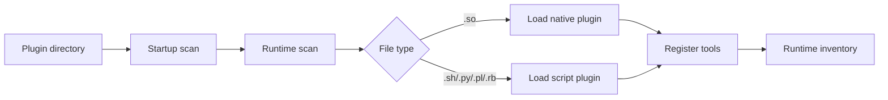

Related implementation:
- [src/plugin_manager.c](../src/plugin_manager.c)
- [src/tool_registry.c](../src/tool_registry.c)

---

## 2. Native plugin support

- Loads compiled .so plugin modules with dlopen
- Validates the plugin API version before activation
- Resolves required symbols such as init, get_tool_count, get_tool, invoke, and deinit
- Ensures plugin compatibility with the runtime before registration
- Prevents activation of unsupported or mismatched plugin builds

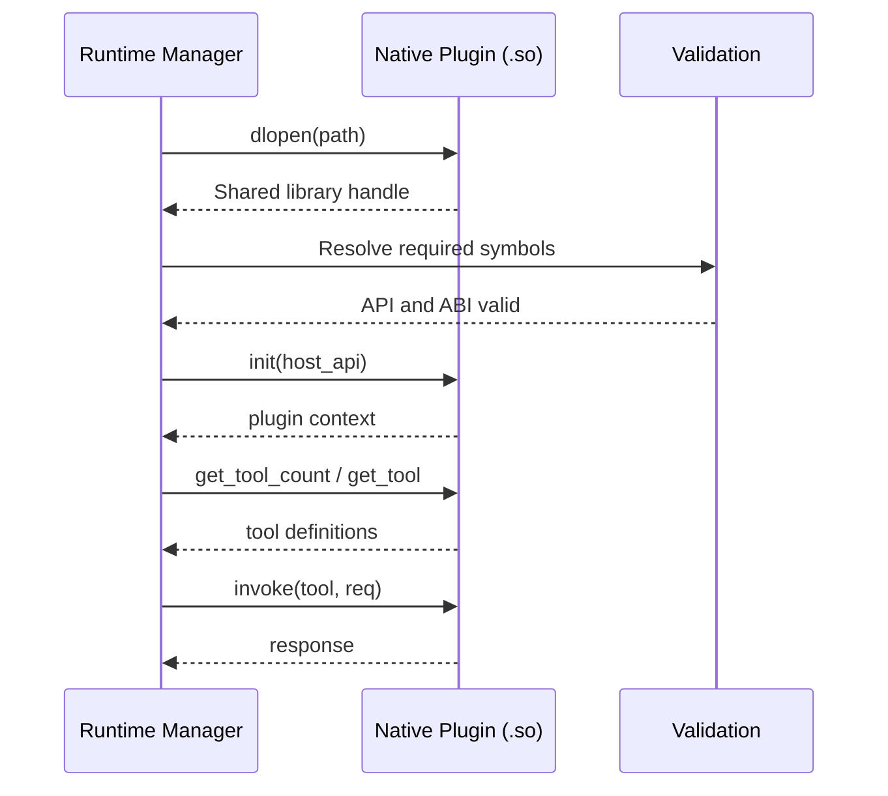

Supported behavior:
- ABI validation
- Symbol resolution checks
- Compatibility enforcement
- Safe activation only after verification

---

## 3. Script plugin support

- Loads executable plugin scripts in supported formats such as .sh, .py, .pl, and .rb
- Parses tool metadata from script-provided JSON output
- Registers tool names and descriptions without requiring a compiled plugin binary
- Invokes script-based tools by name through the same runtime dispatch path
- Keeps script plugins consistent with the native plugin lifecycle model

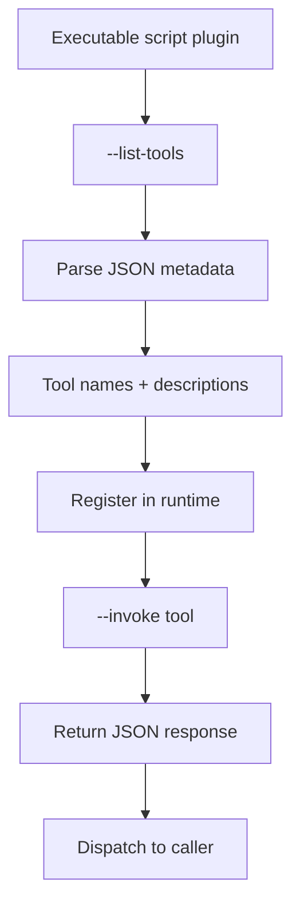

This enables a lower-friction extension model while preserving a unified runtime experience.

---

## 4. Runtime registration and tool binding

- Maintains a central tool registry keyed by tool name
- Binds each tool to its provider plugin instance
- Resolves invocation requests by name at runtime
- Tracks active plugin ownership and tool ownership for each binding
- Supports conflict handling when a tool name is duplicated

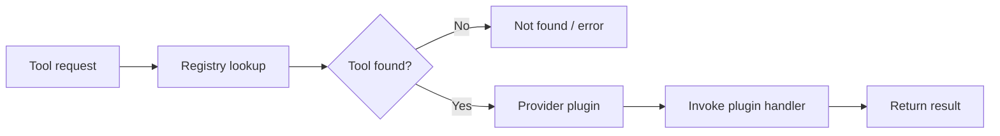

Key capabilities:
- Duplicate detection
- Controlled registration policy
- Safe provider lookup
- Runtime dispatch by tool name

---

## 5. Startup and dynamic inventory visibility

- Emits a startup inventory log with the header: SUPPORTED TOOLS ON STARTUP
- Emits dynamic registration logs with the header: DYNAMIC TOOLS
- Logs plugin metadata such as tool name, description, and plan stage
- Makes supported capabilities visible at process boot and during plugin add events
- Helps operators confirm what the runtime is exposing at any time

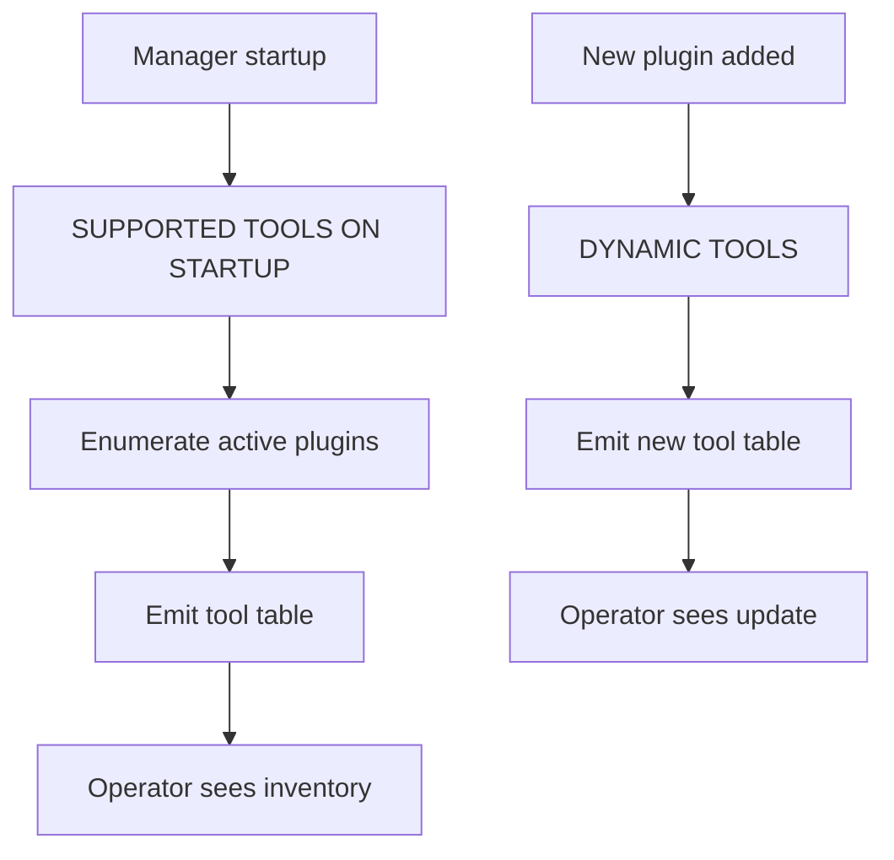

---

## 6. Plugin lifecycle management

The module manages a complete plugin lifecycle:

- discovery
- validation
- load
- registration
- active use
- file change detection
- unload on replacement or removal
- cleanup of stale state

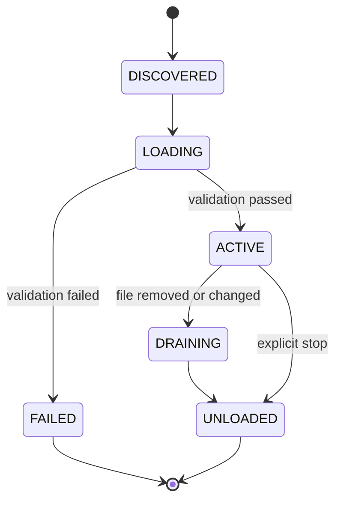

This keeps the runtime robust when plugins are added, updated, or removed while the process remains running.

---

## 7. Watcher and refresh modes

- Poll-based refresh mode
- Linux inotify-based refresh mode
- Optional startup scan and periodic rescan logic
- Debounce control to avoid excessive churn during rapid file changes

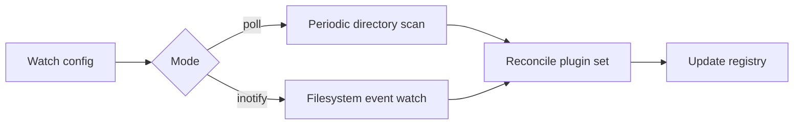

This allows the runtime to adapt to filesystem updates without requiring a process restart.

---

## 8. Security and path validation

- Restricts plugin loading to trusted directories
- Rejects files outside the configured allowed plugin roots
- Verifies owner and file type before accepting a plugin
- Blocks writable group or world permissions
- Avoids loading unsafe or unexpected plugin artifacts

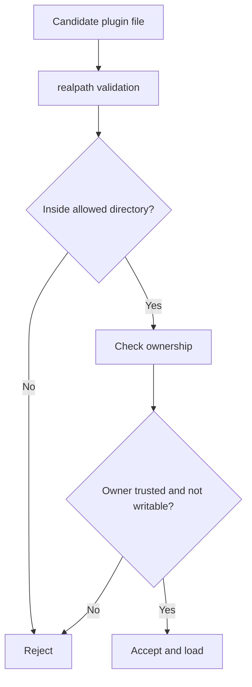

This reduces the chance of untrusted or malformed plugin files being activated.

---

## 9. Metrics and observability

- Counts total plugins loaded
- Counts failed plugin loads
- Counts tools registered
- Tracks plugin invocations and invocation errors
- Exposes runtime metrics through the manager interface

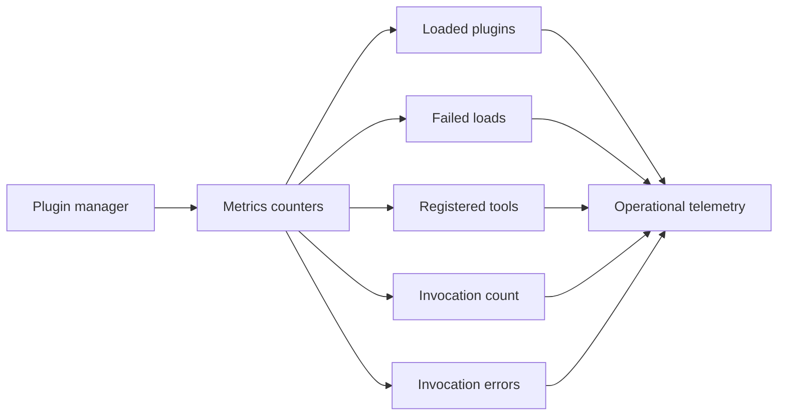

This gives the runtime a measurable operational profile and helps diagnose plugin health.

---

## 10. Manifest and operational state persistence

- Generates a plugin manifest file describing currently active plugin paths and tools
- Captures a structured runtime inventory for operational inspection
- Supports later validation or auditing of the active plugin set

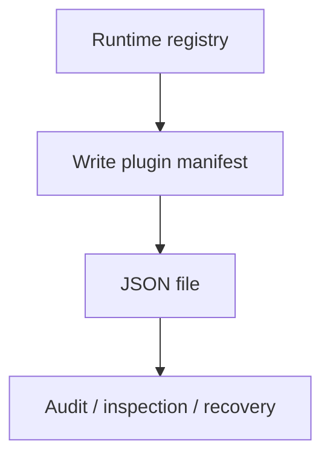

---

## 11. Packaging and deployment compatibility

- Builds native shared-library output as .so artifacts
- Stages plugin payloads in the configured dynamic directory
- Supports installation into runtime-owned dynamic plugin paths instead of legacy static library locations
- Keeps deployment aligned with runtime-owned plugin discovery behavior

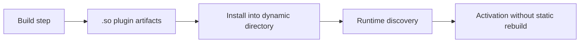

---

## 12. Summary

The module’s primary capabilities are:

- dynamic tool discovery
- runtime plugin loading
- script-based extension support
- safe validation and path confinement
- lifecycle management
- registry-based dispatch
- startup and dynamic observability
- plugin metadata tracking
- operational metrics and manifest generation

This is a runtime extension framework, not just a list of commands or tools.
